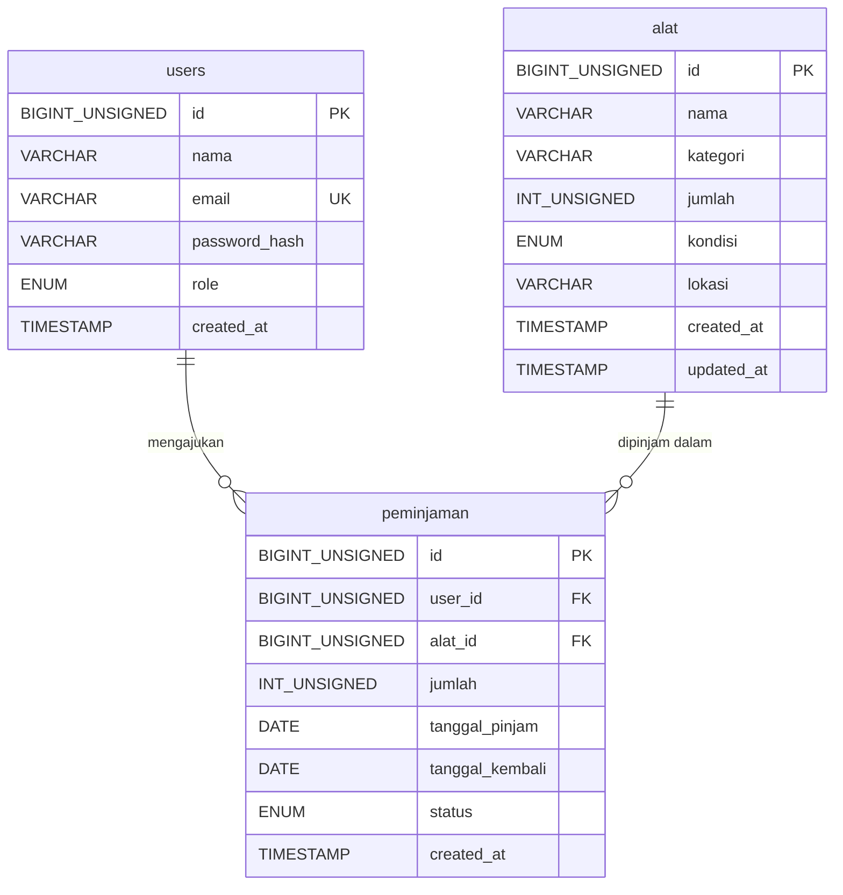

# ERD dan Data Dictionary - Pemweb OBE

**Kardinalitas:** satu `users` dapat memiliki 0..N `peminjaman`; satu `alat` dapat muncul pada 0..N `peminjaman`; setiap `peminjaman` wajib terhubung ke satu `users` dan satu `alat`. Jadi `peminjaman` adalah tabel penghubung many-to-many antara `users` dan `alat`.

## Data dictionary ringkas

| Tabel | Kolom penting | Keterangan |
|---|---|---|
| users | email (UNIQUE), password_hash, role | Akun; password disimpan sebagai hash |
| alat | kategori (INDEX), jumlah, kondisi, lokasi | Inventaris alat laboratorium |
| peminjaman | user_id (FK), alat_id (FK), status | Transaksi pinjam |